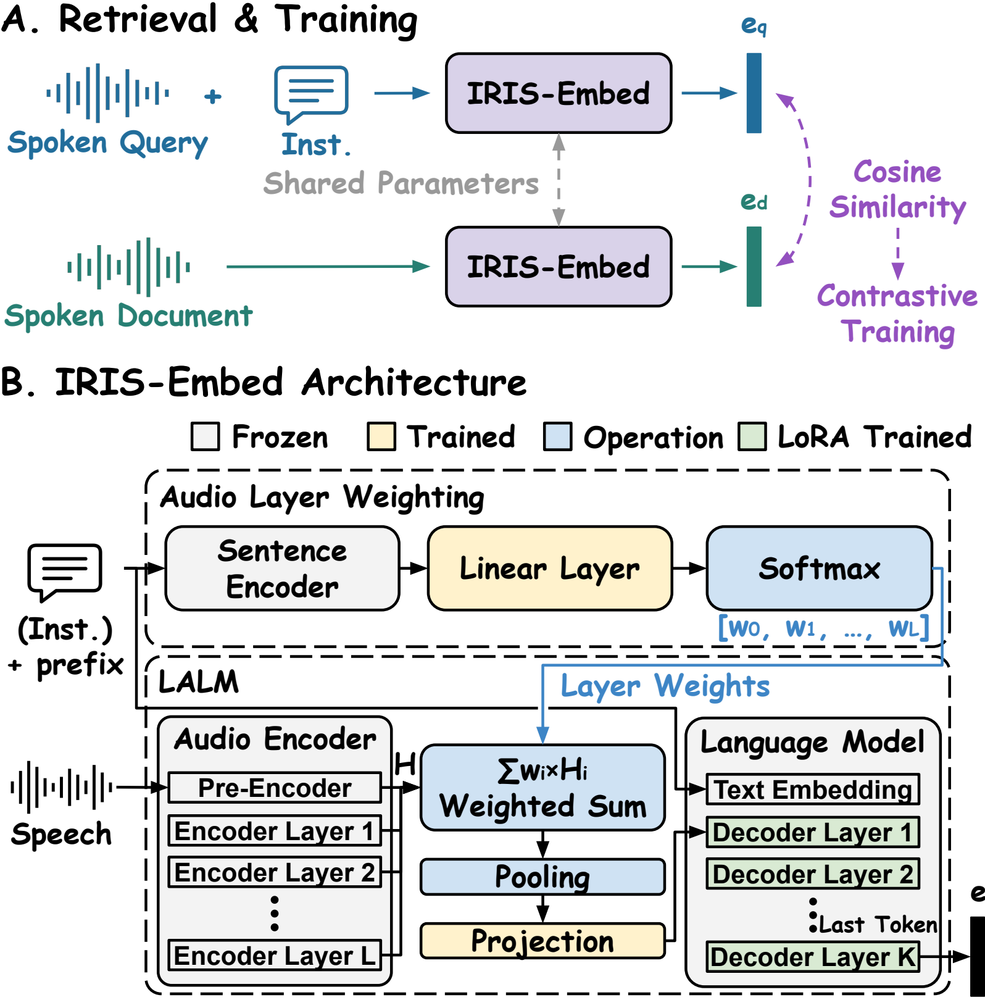

# IRIS: Instruction-Aware Retrieval for Speech

This repository contains the code, checkpoints, and experiments for IRIS.

## IRIS-Embed

[](https://arxiv.org/abs/2611.09122)

IRIS-Embed is a speech embedding model for instruction-aware retrieval.
The query instruction specifies what to retrieve.
Documents are encoded without a query instruction.

| Backbone | Hugging Face checkpoint | Embedding dimensions |
| --- | --- | --- |
| Qwen2.5-Omni-3B | [lca0503/IRIS-Embed-Qwen2.5-Omni-3B](https://huggingface.co/lca0503/IRIS-Embed-Qwen2.5-Omni-3B) | 2048 |
| Gemma-4-E2B-it | [lca0503/IRIS-Embed-gemma-4-E2B-it](https://huggingface.co/lca0503/IRIS-Embed-gemma-4-E2B-it) | 1536 |

Audio layer weight module predicts weights for combining audio encoder layers before projection.
We train LLM LoRA, the weight module routing head, and the audio projection.
The pretrained sentence encoder and audio encoder are frozen.

<p align="center">
  <a href="assets/embed/model_framework.pdf">
    
  </a>
</p>

## Quick start

Use Python 3.12, PyTorch 2.11, and torchvision 0.26.
Install IRIS:

```bash
python -m pip install -e .
```

Transformers is pinned to 5.8.1.

```python
from iris.embed.inference import IRISEmbedder

model = IRISEmbedder.from_pretrained("lca0503/IRIS-Embed-Qwen2.5-Omni-3B")
queries = model.encode_queries(
    ["data/query.wav"], instructions="Same speaker."
)
documents = model.encode_documents(["data/document.wav"])
similarities = queries @ documents.T
```

For Gemma, use `lca0503/IRIS-Embed-gemma-4-E2B-it` as the model ID.
You can also pass a local exported checkpoint directory.
Use the same checkpoint for queries and documents.

Both encoding methods return L2-normalized float32 arrays with shape `(num_recordings, embedding_dimensions)`.
Pass `normalize=False` to get unnormalized embeddings.
The model, processor, layer weights, and prompt template are loaded from the checkpoint with `trust_remote_code=True`.

See the [inference examples](examples/embed/inference/README.md) for encoding audio files and retrieving documents.

## Training

Follow the [training guide](examples/embed/training/README.md) to prepare data, train a model, and export its checkpoint.
Training takes train/validation JSONL files and audio paths.

You can use the final encoder layer, a specific layer, mean pooling, global layer weights, or MiniLM layer weights.
The audio projection can be frozen or trained.
You can also train the full audio encoder alongside LLM LoRA.

Training uses [ms-swift with the IRIS patch](patches/ms-swift/README.md).
Inference and evaluation use Hugging Face checkpoints and do not need ms-swift.

## Experiments

| Experiment | Guide |
| --- | --- |
| INSPIRE Recall and NDCG by split or relevance | [Evaluation](examples/embed/experiments/inspire/README.md) |
| Instruction types, robustness, and composition | [Instruction experiments](examples/embed/experiments/inspire/README.md#instruction-experiments) |
| Raw and RMS-adjusted audio layer weights | [Layer weight plots](examples/embed/experiments/inspire/layer_weights.md) |
| MAEB task generalization | [MAEB evaluation](examples/embed/experiments/maeb/README.md) |

Install `python -m pip install -e '.[experiments]'` for INSPIRE and its analyses.
Use a separate environment with `python -m pip install -e '.[maeb]'` for MAEB.

## Citation

If you find our code or models helpful, please consider citing our paper using the following BibTeX:

```bibtex
@article{li2026improving,
  title   = {Improving Large Audio-Language Model Embedding Baselines for Instruction-Aware Speech Retrieval},
  author  = {Li, Chen-An and Chiang, Cheng-Han and Lee, Hung-yi},
  journal = {arXiv preprint arXiv:2611.09122},
  year    = {2026}
}
```
